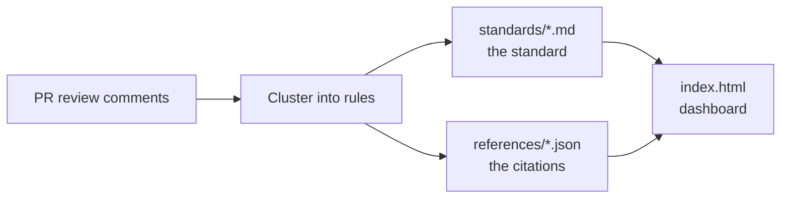

# Engineering Standards

> Plain-language coding standards for **Euna Payments**, mined from real pull request reviews.


<!-- SCREENSHOT (priority): the local dashboard. Run `make dashboard`, screenshot it,
     and save as docs/images/dashboard.png. See docs/images/README.md. -->


<sub>The self-contained dashboard. Every rule shows the real review comments it came from, as clickable links.</sub>

> [!NOTE]
> This repo is the **source of truth** for how we write code. Per-repo tooling (formatters,
> linters, CI) is configured to match these pages, not the other way around. Individual repos
> may declare their own exceptions.

## What makes this different

- **Grounded in evidence.** Every rule is distilled from real PR review comments by our senior reviewers, not invented.
- **Human-language first.** Rules a person or an agent can reason about; tooling is derived from them, not the reverse.
- **Traceable.** Each rule links back to the exact review comments it came from.
- **Browsable.** A zero-dependency dashboard renders every rule and its citations, standalone or served.

## How it works



Reviewers' corrections are the strongest signal for what belongs in a standard. We mine them,
cluster the recurring ones into rules, write each rule in plain language, and keep a
machine-readable trail from every rule back to the comments behind it.

## The standards

| Topic | Covers |
| --- | --- |
| [Modules](standards/elixir/topics/modules.md) | namespacing, aliasing, single responsibility |
| [Naming](standards/elixir/topics/naming.md) | names for modules, functions, variables, files |
| [Control structures](standards/elixir/topics/control-structures.md) | `with`, `case`/`cond`, guards, pipelines |
| [Idioms](standards/elixir/topics/idioms.md) | the preferred, concrete way to write common things |
| [Database](standards/elixir/topics/database.md) | Ecto changesets, queries, migrations, bulk and streaming |
| [Oban](standards/elixir/topics/oban.md) | background jobs: workers, queues, retries, config, testing |
| [Anti-patterns](standards/elixir/topics/anti-patterns.md) | concrete patterns to avoid |
| [Principles](standards/elixir/topics/principles.md) | the design philosophy behind the rules |
| [Application configuration](standards/elixir/topics/application-configuration.md) | compile-time vs runtime, secrets, fail-fast config |
| [Unit testing](standards/elixir/topics/unit-testing.md) | ExUnit structure, mocks and Mox, setup, factories, assertions |
| [Property testing](standards/elixir/topics/property-testing.md) | StreamData generators, `check all`, property invariants |
| [Tooling](standards/elixir/topics/tooling.md) | deps, mix.exs, formatter, Credo, Dialyzer, CI |
| [Security](standards/elixir/topics/security.md) | secrets and PII, authorization and IDOR, untrusted input |
| [OpenAPI schemas](standards/elixir/topics/open-api-specs.md) | OpenApiSpex schemas, operations, and validation |

> [!TIP]
> New to the codebase? Start with **Principles** for the "why," then **Idioms** for the "how."

## Dashboard

<!-- SCREENSHOT: a close-up of one rule with its reference links.
     Save as docs/images/rule-with-references.png. See docs/images/README.md. -->


The dashboard is a single self-contained `index.html`, generated from the docs and their
references stores. Build it and open it locally with one command:

```bash
make dashboard
```

That regenerates `index.html` and opens it standalone in your browser. Use `make
dashboard-serve` to serve it over http. The file is generated, not committed, so build it
locally (or in CI); it never lives in the repo.

## Repository layout

```
standards/        the standards (SOURCE OF TRUTH)
  elixir/
    README.md     generated index: every rule name by topic and section
    topics/       one Markdown file per topic; each rule is a `#### ` heading under a `## ` section
references/        per-rule metadata (name, tags, PR references); one JSON store per doc
scripts/           Elixir tooling: the parser, the dashboard build, the index, and the lint
AGENTS.md          entry point for coding agents
```

- Each collection is a folder under `standards/`, with its own README.
- The `.md` docs are authoritative. Per-rule metadata (name, tags, references) lives in
  `references/`, joined to the docs by rule name; the two must stay 1:1: `make lint` and
  `make dashboard` fail otherwise.
- To add or change a rule, follow `agents/skills/add-rule.md`.

## Status and roadmap

- [x] Elixir standards: modules, naming, control structures, idioms, anti-patterns, principles, application configuration
- [x] Testing standards: property testing and unit testing; tooling standard
- [x] One rule per heading, references stores, generated dashboard, `make lint`, CI
- [ ] Render sections as filterable tags; arbitrary per-rule tags
- [ ] Private, org-only hosting for the dashboard

## For agents

See [AGENTS.md](AGENTS.md) for the operational map: layout, house rules, and current state.
